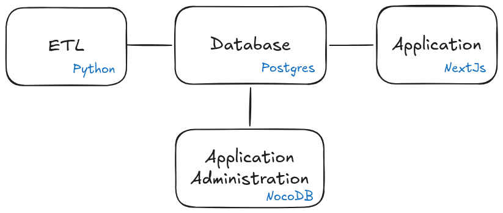

# Adpat Explore



## ETL

Dans le dossier `./backend`, un projet en python

## Application

Dans le dossier `./frontend`, un projet en NextJS

## Application administration

Nous utilisont [NocoDB](https://docs.nocodb.com/) comme application d'administration. NocoDB est démarré via `compose.yml`

Une fois démarrée l'application est disponible sur `http://localhost:3333`.

Aucun paramétrages n'aient fait au démarrage de l'application donc à son premier lancement il vous faudra :

- Créer un utilisateur super admin
- Créer une intégration de la base de données `adpat_explore`
- Ajouter cette intégration comme source de donnée

## Variables d'environnement

Copier le fichier `.env.example` et créer un fichier `.env`

```
cp .env.example .env
```

## Démarrer l'infrascruture

```
podman compose up -d
# OU
docker compose up -d
```

## Migration de schema

Les migrations de schema sont gérer par [yoyo-migrations](https://ollycope.com/software/yoyo/latest/#).

Dans le dossier `./database`, si c'est le premier lancement installez les dépendances

```
uv sync
```

Vérifier que la base de données est démarrée (cf. Démarrer l'infrascruture) et jouer les migrations

```
uv run --env-file ../.env yoyo apply
```

Pour ajouter un nouveau fichier de migration

```
uv run --env-file ../.env yoyo new --sql -m "..."
```

## Remplir la base de donnée

Vous pouvez remplir la base de donnée avec données aléatoires, cela peut-être utile pendant les développements frontend

Dans le dossier `./frontend`

```
# Remplir la database
npm run db:seed -- --up

# Truncate la database
npm run db:seed -- --down
```

## Démarrer l'application frontend

Dans le dossier `./frontend`

```
npm run dev
```

## Mettre à jour les schemas Drizzle

Quand le schema de la base de donnée évolue il peut-être necessaire de mettre à jour les schemas Drizzle pour synchroniser les deux.

Dans le dossier `./frontend`

```
npm run db:introspect
```
